  

  
  
  

  

Fullstack developer from Argentina and **University Technician in Programming**. I design, build and maintain an ERP system at **NETIZAR S.A.** with React, Node.js, TypeScript and MySQL, and I like turning messy business processes into software that's simple to use.

I'm also a **Claude expert** 🧙: I use Claude and Claude Code every day to plan features, write and refactor code, review changes and squash bugs faster, without giving up code quality. English level: **B2**.

  
  

  
  

<b>NETIZAR S.A.</b> · Software Developer · <i>now</i>

 

- Design, development and maintenance of the company's ERP system.
- Fullstack work with TypeScript, Node.js, Express, React and MySQL.
- AI-assisted workflow with Claude Code for planning, refactoring and code review.

<b>University Technician in Programming</b> · Graduated 🎓

 

- Algorithms, data structures, OOP and relational databases.

 

  

  
  

  
   
  
  
  
  
  

  

